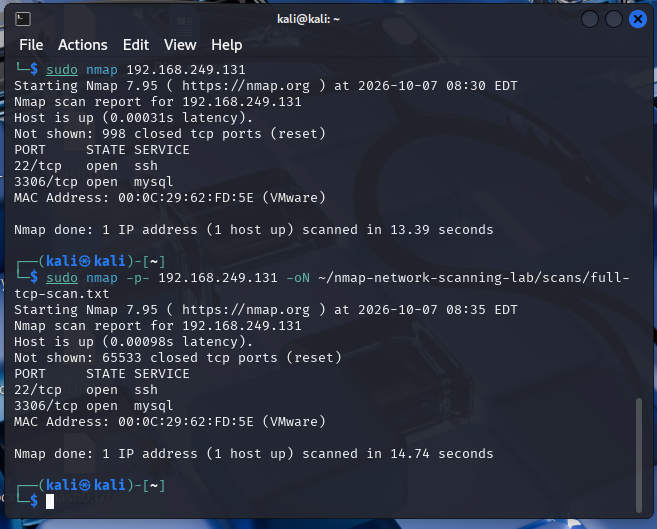
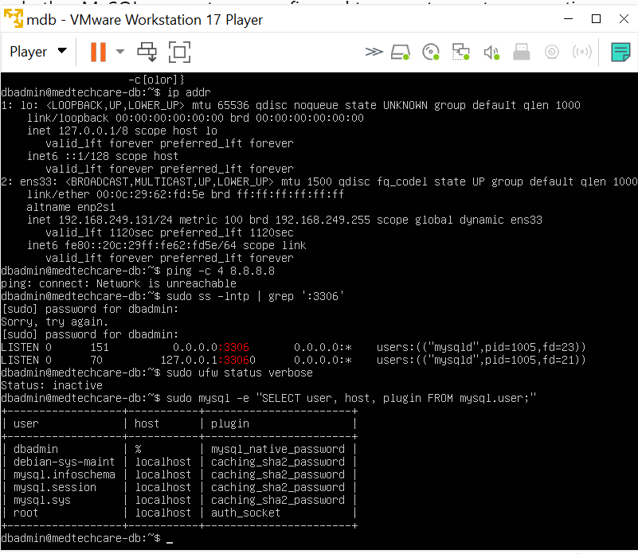

# Nmap Network Scanning & Risk-Based Vulnerability Assessment

**An authorised, evidence-led security assessment of an isolated Kali Linux / Ubuntu VMware laboratory.**

**Author:** Ajibade Michael  
**Assessment period:** 7–16 October 2026  
**Tools:** Nmap 7.95 · Kali Linux 2025.1a · Ubuntu 22.04.5 LTS · VMware · MySQL · OpenSSH  
**Scope:** Personal educational proof-of-concept (PoC) environment; synthetic MedTechCare dataset

> **Educational and ethical scope:** Both virtual machines were controlled by the assessor, and testing was restricted to the deliberately isolated VMware subnet. The MedTechCare database and the broad-access `dbadmin` user were set up for a previous MSc proof of concept. They do **not** represent an incident or an unexpectedly vulnerable production organisation. No brute-force attack, exploit, unauthorised access or real patient-data exposure is claimed.

## Project overview

The objective was to move beyond listing open ports: discover a known target, identify exposed services, validate scanner observations directly on the Ubuntu host, and assess security implications in context. The assessment demonstrates how penetration-testing observations can support risk-based prioritisation without overstating vulnerabilities.

**[📄 Read the full chronological assessment report (PDF)](report/Nmap_Vulnerability_Assessment.pdf)**

The report walks through the project **from beginning to end**, placing cropped evidence screenshots alongside the relevant commands and interpretation.

## Laboratory architecture

```text
               Intentionally isolated VMware subnet
                         192.168.249.0/24

    Kali Linux (assessor)  ────────────▶  Ubuntu (target)
       192.168.249.132                   192.168.249.131
       Nmap 7.95                         SSH 22/tcp
                                         MySQL 3306/tcp

                    No route to public internet
```

The additional addresses observed during subnet discovery were not selected for detailed testing. The private IP addresses shown here identify **only the test lab**, not public targets.

## Methodology and results

| Stage | Method | Evidence / observation |
|---|---|---|
| 1. Identify lab network | `ip addr`, `nmap --version` | Kali on `192.168.249.132/24`; Nmap 7.95 |
| 2. Discover hosts | `nmap -sn` | 4 hosts responded on the lab subnet |
| 3. Default TCP scan | `nmap 192.168.249.131` | 22/tcp (SSH), 3306/tcp (MySQL) open |
| 4. Full TCP scan | `nmap -p-` | 2 open; 65,533 closed TCP ports |
| 5. Version detection | `nmap -sV` | OpenSSH 8.9p1 Ubuntu revision; MySQL 8.0.46 |
| 6. OS fingerprinting | `nmap -O` | Ambiguous Linux/router fingerprints; Ubuntu verified locally |
| 7. SSH protocol review | `ssh2-enum-algos` NSE | Modern algorithms plus SHA-1-based MAC compatibility options |
| 8. MySQL protocol review | `mysql-info` NSE | Handshake version and advertised authentication plugin |
| 9. Limited password check | `mysql-empty-password` NSE | No positive result; **not** proof of strong authentication |
| 10. Target-side validation | Ubuntu package/`ss`/UFW/MySQL queries | Verified patch revision, listener exposure and lab-account grants |

The exact commands, in order, are documented in **[methodology/commands.md](methodology/commands.md)**. Original command outputs were preserved privately; the committed `.txt` files are reviewed public copies.

## Key security findings

| ID | Evidence-based result | Interpretation |
|---|---|---|
| **MY-01** | MySQL listening at `0.0.0.0:3306`, accessible from Kali; UFW inactive; `dbadmin@'%'` has extensive privileges on two **synthetic lab** databases | **Confirmed intentional broad-access configuration.** Potentially important in a real deployment if similarly exposed without compensating controls; not evidence of compromise. |
| **SSH-01** | Installed `openssh-server` package `1:8.9p1-3ubuntu0.16` | Newer than Ubuntu's CVE-2024-6387 fixed revision `1:8.9p1-3ubuntu0.10`; **not an unpatched finding for that CVE**. |
| **SSH-02** | SSH advertises some SHA-1-based MAC options along with modern algorithms | Configuration/hardening observation; policy-dependent, **no exploit demonstrated**. |
| **OBS-01** | `mysql-empty-password` NSE produced no positive script finding | **Inconclusive negative check**, not confirmation that all accounts have strong passwords. |
| **LIMIT-01** | Ubuntu intentionally could not access package repositories | Current update status could not be fully evaluated; the lab was intentionally offline. |

**Risk-based lesson:** An open port or upstream product version does not automatically equal an exploitable vulnerability. Actual exposure, patch status, intended architecture, privileges, impact and evidence quality all matter.

## Selected evidence

| Early reconnaissance | Host-side MySQL validation |
|---|---|
|  |  |

The full **[screenshots directory](screenshots/)** contains 15 cropped images. The MySQL handshake's transient salt was redacted in the public image and output. See [evidence/release-notes.md](evidence/release-notes.md).

## Repository contents

```text
nmap-network-scanning-lab/
├── README.md
├── report/
│   └── Nmap_Vulnerability_Assessment.pdf
├── scans/
│   ├── host-discovery.txt
│   ├── full-tcp-scan.txt
│   ├── service-version-detection.txt
│   ├── os-detection.txt
│   ├── ssh-enumeration.txt
│   ├── mysql-info.txt
│   └── mysql-empty-password.txt
├── screenshots/
│   └── 15 chronological, cropped evidence images
├── methodology/
│   └── commands.md
└── evidence/
    ├── release-notes.md
    └── SHA256SUMS.txt
```

## Recommendations for production-like deployments

- Restrict MySQL network reachability to approved clients and interfaces; use host/network filtering.
- Scope database accounts to appropriate source hosts and enforce strong, unique authentication.
- Grant the minimum required database privileges rather than broad schema permissions.
- Use vendor security advisories and the actual installed package revision to validate CVEs.
- Review SSH algorithm policy; re-test after any authorised configuration changes.

The lab configuration was preserved as evidence. **These recommendations were not implemented or claimed as remediated during this assessment.**

## Scope and limitations

- Authorised, isolated educational VMs only; synthetic MedTechCare records.
- Comprehensive TCP enumeration of **one authorised Ubuntu host**; no UDP assessment.
- Other responding subnet devices were observed but not selected for detailed testing.
- No exploitation, credential attacks, application testing or compromise was attempted.
- The public report and scan files are reviewed copies. Unmodified originals are retained separately and **not committed**.
- CVE-2024-6387 verification is specific to that CVE, not a comprehensive update audit.

## References

- [Ubuntu CVE-2024-6387](https://ubuntu.com/security/CVE-2024-6387)
- [Ubuntu USN-6859-1](https://ubuntu.com/security/notices/USN-6859-1)
- [Nmap Reference Guide](https://nmap.org/book/man.html)
- [Nmap Scripting Engine documentation](https://nmap.org/nsedoc/)

---

**Created for a cybersecurity learning portfolio and to demonstrate careful, risk-aware security assessment. Only test systems you own or are explicitly authorised to assess.**